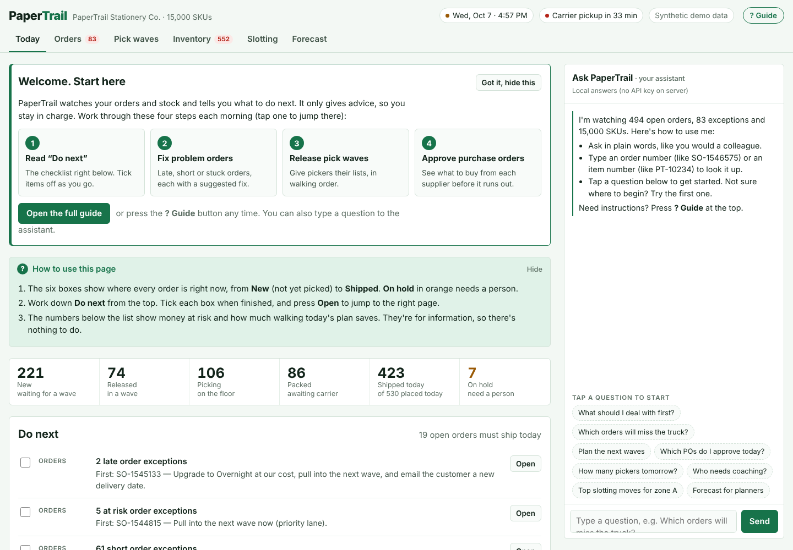

# PaperTrail


**An AI operations agent for a high-volume stationery warehouse.** It watches the order pipeline, tells the ops lead what to deal with first, builds pick waves with walking-order pick lists, keeps reorder points honest, and finds the slot moves that cut the most walking.

I built this to see how far I could take an agent past "chat with your data." The goal was something an operations lead could open at 7 a.m. and use: a ranked to-do list, pick lists a picker can follow, and an assistant that answers questions from the same numbers the dashboard shows.

The business is simulated: 15,000 SKUs, about 5,000 orders a week, six pick zones, sixteen pickers. I generated two years of history (546,700 orders, 1.58 million lines) from a single seed, with the patterns a real stationery distributor deals with: a long-tailed catalog, back-to-school and holiday peaks, planner season, wholesale case orders, promos, launches and phase-outs. Everything below runs on that data, and the engine is written so real exports can replace it (see [Plugging in real data](#plugging-in-real-data)).



**Stack:** Python, pandas, NumPy, FastAPI, the Anthropic API (tool use), pytest, and a single-file vanilla JS dashboard with no build step.

## What it does

| Job | What the agent produces |
|---|---|
| **Order status and exceptions** | Every open order classified as Late, At risk (must ship before the 5:30 pm truck), Short, Stuck, or On hold, each with a specific next action: upgrade shipping, hold for an inbound PO, offer an in-stock substitute in another colour, or call the picker who has it. |
| **Pick waves** | Unreleased orders prioritised by ship-by date and service level, cut into waves of 50, merged by SKU and split by zone, then sequenced in serpentine order. Today's five waves walk 16 km instead of 72 km picked one order at a time (78% less). |
| **Reorder and stockout alerts** | Per-SKU safety stock and reorder points from forecast demand, lead time and an ABC service level; purchase quantities rounded to case packs and grouped by supplier; revenue at risk until stock lands. |
| **Slotting** | A ranked swap list that moves next-six-weeks fast movers into the cheapest slots in their zone. Today only 17–24% of pick visits land in the closest fifth of slots; the ideal is 72–76%. |
| **Forecast** | Category seasonality times a per-SKU smoothed level, backtested on a held-out 8 weeks. |
| **Staffing and people** | Pickers needed for the next five shipping days, and a scorecard that flags accuracy or pace coaching against the team median. |

### Forecast accuracy (8-week holdout, WAPE, lower is better)

| Level | This model | Same week last year | 8-week average |
|---|---|---|---|
| Category × week totals | **6.4%** | 23.5% | 23.1% |
| A items (SKU × week) | **78.3%** | 111.3% | 84.7% |
| All SKUs (SKU × week) | **91.6%** | 129.2% | 98.4% |

Category totals are where buying and staffing decisions are made, and the model is reliable there. SKU-week numbers for slow movers are mostly noise; the reorder logic absorbs that with safety stock rather than pretending a single week is predictable. See `DECISIONS.md`.

## Design choices

- **The model never sees raw tables.** The engine computes everything (forecasts, reorder points, waves, exceptions) and exposes thirteen small tools that return JSON. Claude decides which tools to call and explains the results. Every number it quotes came from a tool call, so the dashboard, the pick list and the assistant can't disagree.
- **It works without the API.** A rule-based router answers from the same tools when there's no key or the API is down. A warehouse floor shouldn't stop because of a rate limit.
- **Simple forecast, honest evaluation.** Category seasonality times a per-SKU smoothed level, backtested on a held-out 8 weeks against two baselines. Individual slow-moving SKUs are noisy week to week, so the reorder logic absorbs that with safety stock instead of trusting one week's number. The reasoning is in `DECISIONS.md`.
- **Recommendations show their math.** Click any SKU and you see the safety stock, reorder point and order quantity worked out step by step. I wanted a buyer to be able to disagree with a number and know why.
- **Advice only.** PaperTrail never writes back to a WMS or ERP. It recommends, and a person approves.

## How it fits together

```
data/generate.py ──► data/raw/*.parquet ──► engine/store.py ─┬─► agent/tools.py ──► agent/agent.py (Claude tool loop)
                                                            │                     └► agent/fallback.py (offline)
                                                            ├─► api/server.py (FastAPI: /api/*, /api/agent)
                                                            └─► export.py ──► ui/data/*.json ──► ui/index.html
```

* `engine/forecast.py` seasonal index per category, exponential smoothing per SKU, robust σ, backtest
* `engine/inventory.py` ABC classes, safety stock, reorder point, order-up-to quantity, stock status
* `engine/orders.py` exception rules and recommended actions, picker scorecard
* `engine/picking.py` wave building, SKU merge, zone split, S-shape routing, distance model
* `engine/slotting.py` slot cost model and the swap list
* `agent/tools.py` thirteen small tools that return computed JSON; the model never sees raw tables

## Run it

```bash
python -m venv .venv && source .venv/bin/activate
pip install -r requirements.txt

python -m papertrail.data.generate     # ~10 s: catalog, slots, 104 weeks of orders, live pipeline
python -m papertrail.export            # runs the engine, writes ui/data/*.json
uvicorn papertrail.api.server:app --reload
# open http://localhost:8000
```

Set `ANTHROPIC_API_KEY` (see `.env.example`) and the chat panel answers through Claude with tool use. Without it, the same panel answers locally from the engine output.

Ask from the terminal:

```bash
python -m papertrail.agent.agent "Which orders will miss the truck?"
```

Run the tests with `pytest -q`. They cover engine invariants, tool contracts, fallback routing, the API, and the Claude loop against a fake client.

For a static copy (GitHub Pages), `python -m papertrail.export --site` writes `docs/`. Hosted that way the chat uses local answers, since a static page has nowhere to keep an API key.

## Walkthrough

The dashboard has an in-app guide (the **? Guide** button, or press `?`) and a short "how to use this page" box on every tab. A typical morning:

1. **Today:** work down the "Do next" list. It's ranked by what costs the most if ignored.
2. **Orders:** each exception has a suggested fix, such as upgrading shipping, holding for an inbound PO, or offering an in-stock substitute.
3. **Pick waves:** open a wave and zone for a pick list in walking order. Floor view switches to large type for use on the warehouse floor.
4. **Inventory:** the purchase plan is grouped by supplier and rounded to case packs, and you can copy it as CSV.
5. **Slotting and Forecast:** a weekly look at which swaps save the most walking, and what demand looks like before busy seasons.

## Plugging in real data

The generator writes five tables; replace them with exports from your WMS or ERP and everything downstream should run unchanged. I haven't tested it against a real export yet, so expect some column mapping:

| File | Columns the engine uses |
|---|---|
| `skus.parquet` | sku, name, category, product_type, variant, color, zone, location, supplier, lead_time_days, case_pack, unit_price, unit_cost, on_hand, allocated |
| `locations.parquet` | location, zone, aisle, side, bay, level, x, y, dist_to_pack_m, slot_cost_m |
| `orders.parquet` | order_id, created_at, channel, ship_method, ship_state, ship_by, status, status_since, shipped_at, picker, wave_id, hold_reason, pick_minutes, mispick |
| `order_lines.parquet` | order_id, line_no, sku, qty, qty_allocated |
| `purchase_orders.parquet` | po_id, sku, supplier, qty, eta |

## What's next

- A CSV import command with column validation, so a bad export fails with a useful message instead of a stack trace.
- Hierarchical forecasting to improve the slow-mover SKU-week numbers.
- Write-back to a WMS or ERP behind an approval step.

## Project layout

```
papertrail/
  config.py           business constants: zones, geometry, service levels, the simulation clock
  data/generate.py    synthetic history
  engine/             forecasting, inventory policy, orders, picking, slotting, store
  agent/              tools, Claude loop, offline fallback
  api/server.py       FastAPI app
  export.py           engine → JSON for the UI
ui/index.html         single-file dashboard (no build step)
tests/                engine invariants, tool contracts, fallback routing, API, Claude loop with a fake client
DECISIONS.md          the design choices, written as interview answers
```
